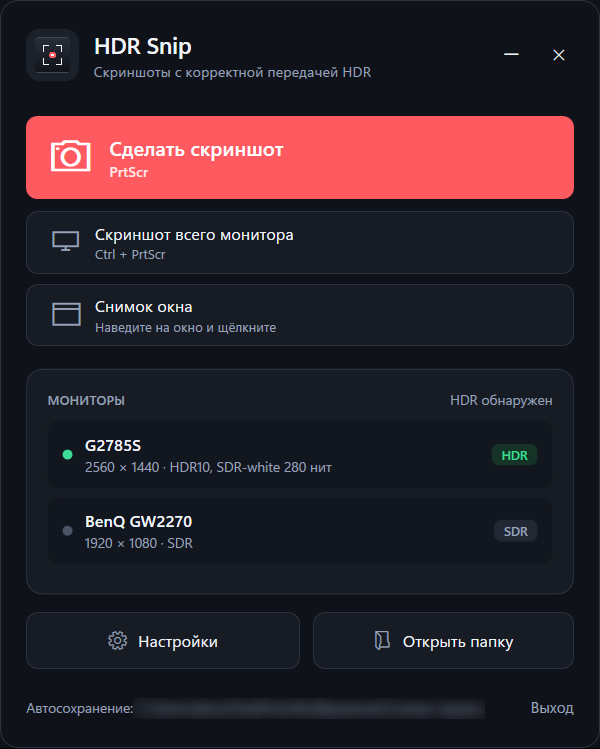
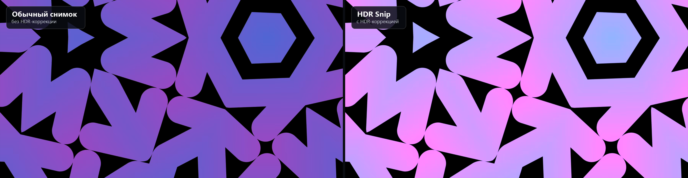
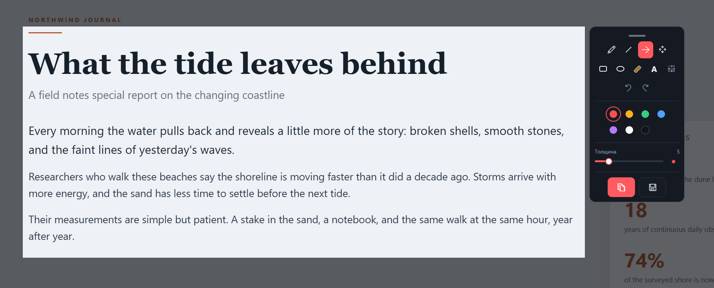
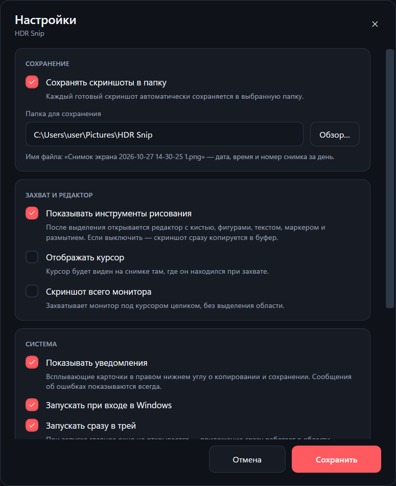

# HDR Snip

Скриншотер для Windows с корректным захватом HDR-мониторов. Заменяет «Ножницы» в повседневной работе: горячая клавиша, выделение области или окна, рисование кистью, фигурами, текстом и размытием, копирование в буфер и автосохранение в PNG.

## Скриншоты

Главное окно: снимок области, всего монитора или окна и список мониторов с пометкой HDR.



HDR-монитор: слева — обычный снимок без коррекции (света выбелены), справа — HDR Snip с пересчётом по уровню SDR-белого.



Редактор: снимок на тёмном рабочем поле, инструменты — на плавающей панели.



Настройки: папка автосохранения, инструменты рисования, курсор, уведомления, автозапуск и горячие клавиши.



Для сравнения использован кадр тестового HDR10-ролика [Jellyfin](https://repo.jellyfin.org/test-videos/) (CC BY-SA 4.0).

## Скачать

Готовая portable-сборка лежит в [Releases](https://github.com/edrusha/HDRSnip/releases/latest).

1. Скачайте `HDRSnip-portable.zip`.
2. Распакуйте в любую папку, куда есть запись (не в `Program Files`).
3. Запустите `HDRSnip.exe`.

Устанавливать .NET не нужно: runtime уже внутри. Права администратора не нужны, настройки хранятся в профиле пользователя.

## Возможности

- **Корректный HDR-захват.** Для HDR-мониторов используется DXGI Desktop Duplication с кадром `R16G16B16A16_FLOAT` (линейный scRGB) и пересчётом в SDR с учётом уровня белого SDR-контента. Скриншоты не выглядят выбеленными.
- **Выделение области** на любом мониторе. Оверлей открывается на всех мониторах, но выделение ограничено тем монитором, где началось перетаскивание.
- **Курсор на снимке.** Курсор отображается на скриншоте — обычная стрелка, I-образный указатель и другие системные курсоры. Настройку можно выключить.
- **Снимок окна.** Наведите курсор на нужное окно и щёлкните: программа сама определит его границы и снимет только его. Свёрнутые и полностью закрытые другими окнами окна не снимаются.
- **Рисование**: кисть, прямая линия, стрелка, прямоугольник, овал, маркер, текст и размытие. Семь цветов, плавная настройка толщины от 1 до 24 ползунком или колесом мыши (в любом месте редактора). Все инструменты находятся в плавающей вертикальной панели сбоку от скриншота. Горячие клавиши: кисть — `1`, линия — `2`, стрелка — `3`, перемещение — `4`, прямоугольник — `5`, овал — `6`, маркер — `7`, текст — `8`, размытие — `9`. С зажатым `Shift` линия и стрелка выравниваются по 0/45/90°, а овал превращается в ровный круг.
- **Текст на снимке.** Выберите инструмент «Текст» (`8`), щёлкните по нужному месту и введите подпись. `Ctrl+Enter` — вставить текст, `Esc` — отменить ввод. У поля ввода и у готовой надписи есть ручки справа, снизу и в правом нижнем углу: тяните их, чтобы увеличить или уменьшить ширину и высоту текстового блока. Ручная ширина включает перенос строк, ручная высота обрезает лишнее. Готовый текст перетаскивается инструментом «Перемещение» (`4`): вокруг надписи появляется рамка с ручками.
- **Размытие и маркер.** Размытие (`9`) превращает выбранную область в мозаику: удобно скрывать пароли, почту и другие личные данные. Маркер (`7`) полупрозрачно подсвечивает важные фрагменты.
- **Отмена и повтор.** `Ctrl+Z` отменяет последнее действие, `Ctrl+Y` или `Ctrl+Shift+Z` возвращает его. На панели есть отдельные кнопки.
- **Запоминание настроек рисования**: инструмент, цвет и толщина запоминаются при закрытии редактора — после копирования, сохранения или даже `Esc`. Следующий снимок открывается с ними.
- **Свободное расположение**: снимок и панель инструментов можно перетаскивать независимо друг от друга. Снимок двигается инструментом «Перемещение» (`4`) или средней кнопкой мыши, панель — за верхнюю ручку или пустое место.
- **Копирование и сохранение**: `Ctrl+C` — в буфер обмена, `Ctrl+S` — PNG в папку. На боковой панели есть кнопки копирования и сохранения.
- **Быстрый режим без рисования**: если инструменты отключены, выделенная область сразу копируется в буфер и при необходимости сохраняется.
- **Захват всего монитора** под курсором одной командой. По умолчанию — `Ctrl+PrtScr`.
- **Снимок окна** из главного окна или меню трея: наведение мышью подсвечивает окно, щелчок снимает его без ручного обведения границ.
- **Работа в трее**: при запуске приложение сразу сворачивается в трей. Левый клик по значку открывает главное окно, правый — меню, двойной — делает снимок. Горячие клавиши работают всегда. Двойной запуск открывает уже работающее окно.
- **Тёмное меню в трее** и настройки отдельным окном поверх главного — без второй иконки в панели задач.
- **Автозапуск** вместе с Windows (необязательно).
- **Понятные уведомления**: собственные карточки в правом нижнем углу сообщают о копировании, сохранении и ошибках. Они не зависят от системных баннеров Windows и не перехватывают фокус.
- **Русский интерфейс**.

## Системные требования

- Windows 10 версии 2004 или новее, Windows 11.
- 64-битная система.

Готовая сборка из Releases работает без установки .NET: нужный runtime уже внутри `HDRSnip.exe`. .NET 10 SDK требуется только для сборки из исходников.

## Установка

1. Скачайте `HDRSnip-portable.zip` из [Releases](https://github.com/edrusha/HDRSnip/releases/latest).
2. Распакуйте архив в любую папку, куда есть запись, например `D:\Tools\HDR Snip`. Распаковывайте целиком: программе нужны все файлы из архива.
3. Запустите `HDRSnip.exe`. Приложение появится в области уведомлений и останется работать в трее, не открывая главное окно.

Ярлык на рабочем столе можно создать вручную — на `HDRSnip.exe`. Права администратора не требуются.

Файлы скачаны из интернета, поэтому при первом запуске Windows SmartScreen может попросить подтверждение: «Подробнее» → «Выполнить в любом случае». Это стандартная метка для скачанных файлов, а не сообщение о вирусе.

Чтобы удалить программу, закройте её через трей, удалите папку с распакованными файлами и папку `%APPDATA%\HDRSnip`.

## Быстрый старт

1. Нажмите **PrtScr** (или кнопку «Сделать скриншот» в окне, или пункт трея «Сделать скриншот»).
2. Зажмите левую кнопку мыши и выделите область. Размер области показывается в пикселях.
3. При необходимости нарисуйте кистью, линией, стрелкой или фигурой, добавьте текст, маркер или размытие. Цвет выбирается на панели, толщина — ползунком или колесом мыши. У текста можно менять ширину и высоту ручками — как при вводе, так и позже инструментом «Перемещение». Снимок и панель можно перетаскивать: снимок — инструментом «Перемещение» (`4`) или средней кнопкой мыши, панель — за верхнюю ручку или пустое место.
4. Нажмите **«Копировать»** (`Ctrl+C`) или **«Сохранить»** (`Ctrl+S`).
5. `Esc` или клик по пустому месту вне снимка — закрыть без сохранения. Клик мимо окна редактора (например, на другом мониторе) тоже закрывает его.

Чтобы сразу снять весь монитор под курсором, нажмите **Ctrl+PrtScr**, кнопку «Скриншот всего монитора» в главном окне или соответствующий пункт меню в трее.

### Снимок окна

1. Нажмите кнопку **«Снимок окна»** в главном окне или выберите **«Снимок окна»** в меню трея.
2. Экран замрёт. Наведите курсор на нужное окно — оно подсветится рамкой и названием, остальное затемнится.
3. Щёлкните левой кнопкой мыши. В редактор попадёт только это окно, без ручного обведения границ.
4. `Esc` или правая кнопка мыши — отмена.

Активировать окно или ждать таймер не нужно: программа определяет окно под курсором сама. Свёрнутое окно снять нельзя, а у окна, которое частично закрыто другим, попадёт только видимая часть.

Если в настройках выключены «Показывать инструменты рисования», после отпускания кнопки мыши снимок сразу копируется в буфер и сохраняется (если включено сохранение).

## Настройки

| Параметр | Что делает |
|---|---|
| **Сохранять скриншоты в файл** | При копировании или сохранении дополнительно записывает PNG в выбранную папку. |
| **Папка** | Куда сохранять файлы. По умолчанию `Изображения\Скриншоты`. |
| **Показывать инструменты рисования** | Открывать редактор с кистью, фигурами, текстом, маркером и размытием. Если выключено — снимок сразу уходит в буфер. |
| **Отображать курсор** | Добавляет курсор на скриншот в том месте, где он находился в момент нажатия горячей клавиши. Если курсор был вне выделенной области, на снимок он не попадёт. |
| **Скриншот всего монитора** | Захватывает целиком монитор, на котором находится курсор, без выделения области. |
| **Показывать уведомления** | Всплывающие подсказки о копировании и сохранении. |
| **Запускать при входе в Windows** | Добавляет приложение в автозапуск текущего пользователя. |
| **Запускать сразу в трей** | При запуске не показывает главное окно. Включено по умолчанию. |
| **Горячие клавиши** | Отдельные сочетания для выделения области (по умолчанию `PrtScr`) и для всего монитора (по умолчанию `Ctrl+PrtScr`). Поддерживается `PrtScr` без модификаторов, функциональные клавиши `F1`–`F24`, а также сочетания с `Ctrl`, `Alt`, `Shift`, `Win`. |

Настройки хранятся в `%APPDATA%\HDRSnip\settings.json` и применяются сразу после сохранения.

## Имена файлов

При сохранении в имя файла автоматически попадают дата, время и номер снимка за этот день:

```
Снимок экрана 2026-10-27 14-30-25 1.png
Снимок экрана 2026-10-27 14-30-26 2.png
Снимок экрана 2026-10-27 14-30-27 3.png
```

- `Снимок экрана` — постоянное начало имени;
- `2026-10-27` — дата: 27 октября 2026 года;
- `14-30-25` — время: 14 часов 30 минут 25 секунд;
- `1`, `2`, `3` — номер снимка за этот день. Первый снимок дня получает `1`, следующий — `2` и так далее. На следующий день нумерация снова начинается с `1`.

Сохраняется PNG без потерь.

В буфер обмена изображение помещается в форматах PNG, DIB и Bitmap — его понимают Paint, Word, Telegram, Discord, Photoshop и другие программы.

## HDR: как это работает

- Для HDR-монитора приложение запрашивает у DXGI формат `R16G16B16A16_FLOAT` через `IDXGIOutput5::DuplicateOutput1`. Это линейный scRGB, где `1.0` соответствует 80 нит.
- Белый цвет обычных SDR-окон операционная система поднимает до уровня «SDR white» (например, 280 нит). Приложение делит значения на этот уровень, поэтому белый остаётся белым, а цвета — естественными.
- Если драйвер всё же вернул 8-битный кадр для HDR-монитора, применяется обратное масштабирование, чтобы убрать выбеленность.
- Для SDR-мониторов используется обычный путь BGRA8.
- Если DXGI недоступен (например, удалённый рабочий стол или защищённый контент), применяется резервный захват GDI.

## Расположение данных

| Что | Где |
|---|---|
| Программа | папка, в которую распакован архив |
| Настройки | `%APPDATA%\HDRSnip\settings.json` |
| Журнал | `%APPDATA%\HDRSnip\log.txt` |

Журнал помогает диагностировать проблемы с захватом. Он автоматически ограничивается по размеру.

## Удаление

1. В настройках выключите «Запускать при входе в Windows».
2. Выйдите из приложения через трей или кнопку «Выход».
3. Удалите папку с распакованными файлами, ярлык с рабочего стола (если создавали) и папку `%APPDATA%\HDRSnip`.

## Сборка из исходников

Нужен .NET SDK 10.

```powershell
dotnet build -c Release
dotnet publish -c Release -r win-x64 --self-contained true -p:PublishSingleFile=true -p:IncludeNativeLibrariesForSelfExtract=true -p:EnableCompressionInSingleFile=true -o publish
```

`publish` содержит один `HDRSnip.exe` со встроенным .NET — его можно запускать на машине без установленного runtime. Для сборки, которой нужен установленный .NET, замените `--self-contained true` на `--self-contained false`.

Во время разработки приложение можно запустить так:

```powershell
dotnet run
```

Проект использует WPF, WinForms только для значка в трее и библиотеки Vortice.DXGI / Vortice.Direct3D11.

## Структура проекта

```
HDRSnip/
  Interop/    Win32, GDI и DXGI P/Invoke
  Models/     настройки, мониторы, горячие клавиши
  Services/   HDR-захват, курсор, буфер обмена, трей, автозапуск
  Theme/      стили WPF
  UI/         оверлей выделения, редактор, уведомления
  App.xaml    точка входа и запуск в трее
```

## Ограничения

- Одновременно можно выделить только одну область.
- Выделение не выходит за пределы монитора, на котором началось перетаскивание.
- Снимок окна берётся с монитора, на котором был щелчок. Свёрнутые окна и окна, полностью закрытые другими, снять нельзя; у частично перекрытого окна попадёт только видимая часть.
- Нет прокручиваемого захвата длинных страниц, OCR и закрепления снимка на экране — это возможные направления развития.
